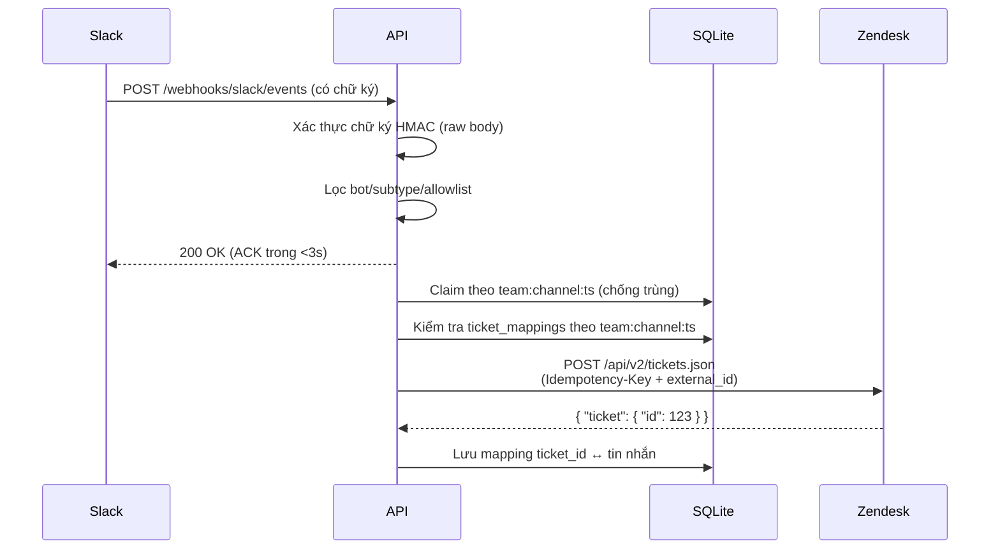
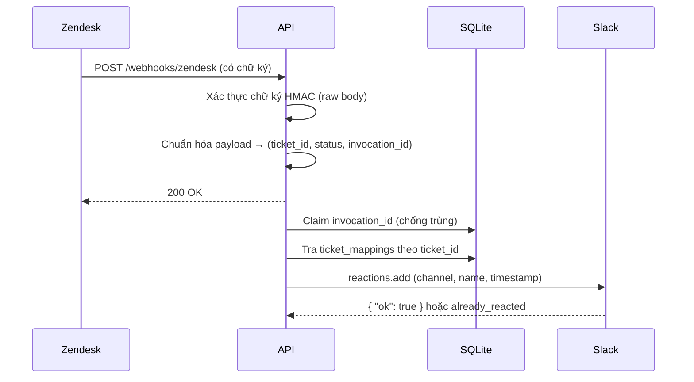

# Zendesk ↔ Slack Bridge

Dự án kết nối hai chiều giữa Slack và Zendesk:

- **Tin nhắn Slack → tạo ticket Zendesk** (nội dung tin nhắn thành comment, ticket được liên kết ngược với tin nhắn gốc).
- **Thay đổi trạng thái ticket Zendesk → thêm reaction trên Slack** (ví dụ `eyes` khi ticket mở, `white_check_mark` khi ticket được giải quyết).

Backend nằm trong thư mục [`api/`](./api). ZAF app (sidebar ticket trong Zendesk) gồm [`zaf/`](./zaf) (manifest) và
[`client/`](./client) (UI host trên Cloudflare Pages) — xem [mục ZAF client](#8-zaf-client).

---

## 1. Cây thư mục

```
zendesk-support/
├── compose.yaml              # Chạy API bằng Docker Compose
├── README.md                 # Tài liệu này
├── api/
│   ├── .env.example          # Mẫu biến môi trường (copy thành .env)
│   ├── .gitignore
│   ├── Dockerfile
│   ├── pytest.ini
│   ├── requirements.txt      # Dependency runtime
│   ├── requirements-dev.txt  # + pytest
│   ├── README.md             # Tài liệu chi tiết phía API
│   ├── app/
│   │   ├── main.py                    # Tạo app, lifespan, khởi tạo DB + client
│   │   ├── core/
│   │   │   ├── config.py              # Cấu hình (pydantic-settings)
│   │   │   └── security.py            # Xác thực chữ ký HMAC Slack + Zendesk
│   │   ├── api/
│   │   │   ├── router.py              # Gom router
│   │   │   ├── deps.py                # Dependency xác thực chữ ký + shared token
│   │   │   ├── payloads.py            # Chuẩn hoá payload đã xác thực
│   │   │   └── endpoints/
│   │   │       ├── health.py          # GET /health
│   │   │       ├── slack.py           # POST /webhooks/slack/events
│   │   │       └── zendesk.py         # POST /webhooks/zendesk
│   │   ├── services/
│   │   │   ├── slack_ticket.py        # Nghiệp vụ tạo ticket + chống trùng
│   │   │   └── zendesk_reaction.py    # Nghiệp vụ thêm reaction
│   │   ├── repositories/              # Truy vấn DB (không chứa nghiệp vụ)
│   │   ├── clients/                   # httpx client cho Zendesk & Slack API
│   │   ├── models/                    # TicketMapping, ProcessedEvent
│   │   ├── db/                        # SQLAlchemy async + session
│   │   └── dependencies/providers.py  # Wiring dependency injection
│   └── tests/                         # 283 test: chữ ký, config, payload, service, deadline, lease, endpoint
├── zaf/                               # Gói app ZAF (chỉ manifest, admin upload 1 lần)
│   ├── manifest.json                  # Manifest ZAF v2, url trỏ tới Cloudflare Pages
│   ├── translations/en.json           # Chuỗi dịch locale mặc định
│   ├── assets/                        # logo.png, logo-small.png
│   └── README.md
└── client/                            # UI sidebar Vite + React + TS, deploy Cloudflare Pages (xem mục 8)
    ├── index.html                     # Thẻ script SDK + entry module
    ├── package.json, vite.config.ts, tsconfig.json, .node-version
    ├── public/_headers                # Header Cloudflare Pages (frame-ancestors)
    ├── src/                           # main.tsx, App.tsx, zaf.ts, slack.ts, style.css, *.test.ts(x)
    └── README.md
```

---

## 2. Kiến trúc

Luồng phụ thuộc đi một chiều, không có vòng lặp:

```
Endpoint (api/)  →  Service  →  Repository  →  Model
                        └──→ Client (httpx tới Zendesk / Slack)
```

| Tầng | Trách nhiệm | Không làm |
| ---- | ----------- | --------- |
| `api/endpoints` | Nhận HTTP, xác thực chữ ký, trả ACK | Không chứa nghiệp vụ, không gọi repository trực tiếp |
| `services` | Nghiệp vụ, điều phối, chống trùng lặp | Không trả HTTP response, không viết SQL thô |
| `repositories` | Truy vấn, lưu bản ghi | Không chứa nghiệp vụ, không ném HTTP exception |
| `clients` | Gọi API bên ngoài, chuẩn hóa lỗi | Không chứa nghiệp vụ nghiệp vụ |

Toàn bộ wiring nằm trong `app/dependencies/providers.py`. HTTP client (Zendesk, Slack) được tạo một
lần khi startup và lưu trên `app.state`, nên kết nối được tái sử dụng.

### 2.1. Luồng: Tin nhắn Slack → Ticket Zendesk



> Slack yêu cầu ACK trong **3 giây**, nên phần tạo ticket chạy ở `BackgroundTasks` — sau khi đã
> trả 200 cho Slack.

### 2.2. Luồng: Trạng thái Zendesk → Reaction Slack



### 2.3. Chống tạo ticket trùng

Không dựa vào `X-Slack-Retry-Num`, và cũng **không** dựa vào `event_id`. Có ba lớp:

1. **Claim theo toạ độ tin nhắn** (`team:channel:ts`) trong bảng `processed_events` bằng
   `INSERT ... ON CONFLICT DO UPDATE ... WHERE` — chống xử lý đồng thời. Toạ độ tin nhắn là ổn định
   suốt đời, còn Slack có thể gán `event_id` **mới** cho một số lần giao lại; nếu khoá theo
   `event_id` thì cùng một tin nhắn vẫn tạo được hai ticket.
2. **Ràng buộc UNIQUE `(slack_team_id, slack_channel_id, slack_message_ts)`** trên `ticket_mappings`
   — lớp bảo vệ ở tầng cơ sở dữ liệu, áp dụng cả khi có hai tiến trình cùng chạy.
3. **Header `Idempotency-Key`** gửi lên Zendesk (giá trị suy ra từ toạ độ tin nhắn). Lưu ý:
   `external_id` của Zendesk **không** là duy nhất, nên nó chỉ dùng để đối chiếu, không dùng để
   chống trùng.

Bản ghi mapping **chỉ được commit sau khi** Zendesk xác nhận tạo ticket thành công.

### 2.4. Trạng thái claim và khả năng thử lại

Bảng `processed_events` lưu trạng thái theo ba giá trị:

| Trạng thái | Ý nghĩa | Có thể thử lại? |
| ---------- | -------- | ---------------- |
| `processing` | Đang xử lý | Chỉ khi quá `PROCESSING_CLAIM_TIMEOUT_SECONDS` (mặc định 900s) — tức tiến trình đã chết hoặc treo |
| `completed` | Thành công | Không (chặn trùng) |
| `failed` | Thất bại | **Có** — lần giao lại sẽ thử lại |

Mỗi lần claim sinh ra một **owner token** (một thế hệ claim mới). `complete()`, `fail()` **và**
`release()` đều chỉ được ghi khi khớp đúng token **và** trạng thái vẫn là `processing`. Nhờ vậy một worker
bị treo, đã hết hạn và bị worker khác thay thế, **không thể** ghi đè kết quả mới bằng kết quả cũ của nó
— kể cả khi việc ghi nhận thất bại của chính nó bị lỗi. Nếu không, một dòng `completed` sẽ bị xoá và
lần giao lại kế tiếp sẽ tạo ticket trùng.

#### Giới hạn tổng thời gian cho upstream

`HTTP_TIMEOUT_SECONDS` của httpx áp dụng **cho từng pha** (connect / read / write / pool), nên một
request có thể kéo dài gấp nhiều lần. Vì vậy mỗi lần gọi Zendesk/Slack được bọc trong
`asyncio.timeout(PROCESSING_DEADLINE_SECONDS)` — đây là **tổng** thời gian cho cả lệnh gọi.

Vì vậy `PROCESSING_CLAIM_TIMEOUT_SECONDS` **bắt buộc phải lớn hơn hoặc bằng**
`PROCESSING_DEADLINE_SECONDS + CLAIM_TIMEOUT_MARGIN_SECONDS`. Nếu lease ngắn hơn tổng thời gian một
lần gọi, worker thứ hai sẽ giành claim khi worker thứ nhất còn đang gọi. Ứng dụng **từ chối khởi
động** nếu cấu hình vi phạm quan hệ này.

Khi hết deadline, upstream **không** trả lời được gì; claim được **giải phóng** (xoá dòng) để lần
giao lại sau đó thử lại ngay, thay vì phải chờ lease hết hạn. Lỗi này là *retryable*, không phải
lỗi chí mạng.

Khi Zendesk hoặc Slack báo lỗi, claim được chuyển sang `failed` thay vì bị xoá, nên một lần giao lại
sau đó vẫn thử được; lần thử lại đó **cập nhật lại cùng một dòng** và tăng `attempts`. Trường hợp ticket
chưa có mapping (Zendesk báo trạng thái trước khi tác vụ tạo ticket kịp chạy xong) cũng được coi là
**có thể thử lại**, không phải trạng thái cuối.

Phía Zendesk chống trùng theo `invocation_id` (fallback sang `zendesk_event_id`, rồi `id`).

---

## 3. Yêu cầu trước khi bắt đầu

| Thành phần | Phiên bản / Ghi chú |
| ---------- | -------------------- |
| Python | 3.12+ |
| Docker + Docker Compose | Chỉ cần nếu chạy bằng container |
| Tài khoản Slack | Quyền quản trị app để tạo Slack app |
| Tài khoản Zendesk | Quyền admin để tạo webhook / trigger |

Nếu chạy local, endpoint webhook cần **đường dẫn HTTPS công khai** (Slack và Zendesk chỉ gọi được
qua HTTPS). Dùng tunnel như `ngrok http 8000`, `cloudflared tunnel`, hoặc reverse proxy có chứng
thư. Xem [mục giới hạn production](#10-giới-hạn-khi-lên-production).

---

## 4. Cấu hình biến môi trường

```bash
cd api
cp .env.example .env
```

Sau đó mở `.env` và điền các giá trị thật. **Không bao giờ commit file `.env`** (đã nằm trong `.gitignore`).

### 4.1. Nhóm Slack

| Biến | Bắt buộc | Mô tả |
| ---- | -------- | ------ |
| `SLACK_SIGNING_SECRET` | Có | Signing Secret của Slack app (Basic Information → Signing Secret). Dùng để xác thực webhook. |
| `SLACK_BOT_TOKEN` | Có | Bot token dạng `xoxb-...`, cần scope `reactions:write`. |
| `SLACK_CHANNEL_ALLOWLIST` | Không | Danh sách channel ID cho phép, phân tách bằng dấu phẩy, ví dụ `C0123,C0456`. **Để trống = chấp nhận mọi channel** mà bot tham gia. |

### 4.2. Nhóm Zendesk

| Biến | Bắt buộc | Mô tả |
| ---- | -------- | ------ |
| `ZENDESK_SUBDOMAIN` | Có | Chỉ tên subdomain, ví dụ `acme` cho `acme.zendesk.com`. |
| `ZENDESK_WEBHOOK_SECRET` | Có | Signing secret của webhook Zendesk. |
| `ZENDESK_OAUTH_TOKEN` | ưu tiên | OAuth access token — **cách được khuyến nghị**. |
| `ZENDESK_EMAIL` | fallback | Email agent, chỉ dùng khi `ZENDESK_OAUTH_TOKEN` trống. |
| `ZENDESK_API_TOKEN` | fallback | API token, chỉ dùng khi `ZENDESK_OAUTH_TOKEN` trống. |

**Về cách xác thực:** ứng dụng ưu tiên OAuth bearer token. Nếu `ZENDESK_OAUTH_TOKEN` trống, ứng dụng
tự động dùng cặp email + API token. Ứng dụng **sẽ không khởi động** nếu thiếu cả hai.

> **Lưu ý về API token:** Zendesk đang chuyển hướng sang OAuth cho các tích hợp mới. Hãy ưu tiên
> `ZENDESK_OAUTH_TOKEN` khi thiết lập dự án mới; cặp `ZENDESK_EMAIL` + `ZENDESK_API_TOKEN` chỉ được
> giữ lại để tương thích ngược. Tham khảo trực tiếp tài liệu Zendesk hiện hành về lộ trình này —
> repo này không khẳng định mốc thời gian cụ thể.

### 4.3. Nhóm bảo mật

| Biến | Bắt buộc | Mô tả |
| ---- | -------- | ------ |
| `WEBHOOK_SHARED_TOKEN` | Không | Token dùng chung, kiểm tra **bổ sung** cùng chữ ký webhook. **Để trống = tắt lớp này.** |
| `WEBHOOK_SHARED_TOKEN_HEADER` | Không | Tên header mang token, mặc định `X-Webhook-Token`. Đọc động theo cấu hình. |
| `DEV_DISABLE_SIGNATURE_VERIFICATION` | Không | **Chỉ dùng khi dev.** Ứng dụng sẽ **từ chối khởi động** nếu bật biến này mà `ENVIRONMENT` khác `development`. Không có cơ chế bỏ qua nào cho production. |
| `SIGNATURE_TOLERANCE_SECONDS` | Không | Cửa sổ chống replay, mặc định `300` (5 phút). |
| `HTTP_TIMEOUT_SECONDS` | Không | Timeout **theo pha** (connect/read/write/pool) mà httpx dùng. Mặc định `10`. Phải là số dương hữu hạn. |
| `PROCESSING_DEADLINE_SECONDS` | Không | **Tổng** thời gian tối đa cho một lần gọi upstream, áp dụng bằng `asyncio.timeout`. Mặc định `60`. Nên lớn hơn `HTTP_TIMEOUT_SECONDS`. |
| `PROCESSING_CLAIM_TIMEOUT_SECONDS` | Không | Một claim `processing` bị bỏ rơi lâu hơn mốc này được coi là đã chết và cho thử lại. Mặc định `900`. **Phải ≥** `PROCESSING_DEADLINE_SECONDS + CLAIM_TIMEOUT_MARGIN_SECONDS`, nếu không ứng dụng từ chối khởi động. |
| `CLAIM_TIMEOUT_MARGIN_SECONDS` | Không | Biên an toàn giữa tổng deadline và lease. Mặc định `60`. |

### 4.4. Ánh xạ trạng thái → reaction

| Trạng thái Zendesk | Reaction mặc định | Biến ghi đè |
| ------------------ | ------------------ | ----------- |
| `new` / `open` | `eyes` | `REACTION_NEW` / `REACTION_OPEN` |
| `pending` / `hold` | `hourglass_flowing_sand` | `REACTION_PENDING` / `REACTION_HOLD` |
| `solved` / `closed` | `white_check_mark` | `REACTION_SOLVED` / `REACTION_CLOSED` |

Các giá trị này phải là **tên emoji hợp lệ của Slack** (ví dụ `eyes`, `white_check_mark`).

Còn nhóm chung: `APP_NAME`, `LOG_LEVEL`, `ENVIRONMENT`, `DATABASE_URL`.

---

## 5. Chạy dự án

### 5.1. Chạy local bằng venv

```bash
cd api
python3.12 -m venv .venv
.venv/bin/pip install -r requirements.txt
.venv/bin/uvicorn app.main:app --reload --port 8000
```

### 5.2. Chạy bằng Docker Compose

Chạy từ **thư mục gốc** repo (Compose tự dựng context `./api` và nạp `./api/.env`):

```bash
cp api/.env.example api/.env    # nếu chưa tạo, rồi điền giá trị thật
docker compose up --build
```

Các lệnh phụ:

```bash
docker compose logs -f api      # xem log
docker compose down             # dừng
docker compose down -v          # dừng và xoá cả volume dữ liệu
```

Dữ liệu SQLite được lưu trong volume `bridge-data` (ánh xạ vào `/app/data` trong container), nên
dữ liệu vẫn còn sau khi rebuild image.

### 5.3. Kiểm tra dịch vụ

Đây là endpoint duy nhất không yêu cầu chữ ký:

```bash
curl http://localhost:8000/health
```

Kết quả mong đợi:

```json
{"status":"ok"}
```

> Hai endpoint webhook (`/webhooks/slack/events` và `/webhooks/zendesk`) **luôn yêu cầu chữ ký
> HMAC**. Cố gọi bằng `curl` không kèm chữ ký sẽ nhận `401`. Tài liệu này không hướng dẫn gọi
> webhook không chữ ký, vì đó không phải cách sử dụng hợp lệ của dịch vụ.

Ngoài ra có Swagger UI tại `http://localhost:8000/docs` (endpoint này cũng không yêu cầu chữ ký).

---

## 6. Thiết lập Slack

### 6.1. Tạo Slack app

1. Vào <https://api.slack.com/apps> → **Create New App** → chọn **From scratch**.
2. Đặt tên app và chọn workspace.

### 6.2. Bot scopes

Vào **OAuth & Permissions** → **Bot Token Scopes** → **Add an OAuth Scope**, thêm:

| Scope | Mục đích |
| ----- | -------- |
| `reactions:write` | **Bắt buộc** — dùng để thêm reaction vào tin nhắn Slack |
| `channels:history` | **Bắt buộc nếu dùng channel công khai** — Slack chỉ gửi sự kiện `message.channels` khi bot có scope này |
| `groups:history` | **Bắt buộc nếu dùng channel riêng tư** — tương ứng với sự kiện `message.groups` (xem [mục 6.5](#65-channel-công-khai-và-channel-riêng-tư)) |

> **Không thêm scope rộng hơn mức cần.** Ứng dụng chỉ cần `reactions:write` cộng scope history tương
> ứng với loại channel bạn dùng. Tránh thêm `chat:write`, `files:write` hay các scope ghi dữ liệu —
> chúng không cần thiết và làm tăng rủi ro.

> ⚠️ **Sau khi thêm hoặc đổi scope, phải cài lại app (Reinstall to Workspace).** Workspace sẽ dùng
> token cũ cho tới khi app được cài lại. Nếu không cài lại, Slack sẽ báo `missing_scope` và các sự
> kiện sẽ không tới. Ở **OAuth & Permissions** nhấn **Reinstall to Workspace**.

### 6.3. Lấy Signing Secret và Bot token

- **Signing Secret**: mở **Basic Information** → *Signing Secret* → copy giá trị này vào
  `SLACK_SIGNING_SECRET`.
- **Bot Token**: ở **OAuth & Permissions**, copy giá trị `xoxb-...` vào `SLACK_BOT_TOKEN`.
  (Bản này dùng bot token tĩnh để đơn giản hóa việc chạy nhanh; khi lên production nên chuyển sang
  OAuth token lấy từ app manifest.)

### 6.4. Event Subscriptions

1. Mở **Event Subscriptions**, bật **Enable Events**.
2. **Request URL** điền URL HTTPS công khai trỏ tới endpoint của bạn:

   ```
   https://<domain-cua-ban>/webhooks/slack/events
   ```

3. Nhấn **Verify Slack Requests** — ứng dụng sẽ echo lại `challenge`. Phải dùng đúng
   `SLACK_SIGNING_SECRET` đã khai báo, nếu không sẽ nhận `401`.
4. Thêm sự kiện, chọn **đúng loại channel bạn cần** (xem [mục 6.5](#65-channel-công-khai-và-channel-riêng-tư)):

   | Loại channel bạn dùng | Sự kiện cần đăng ký |
   | --------------------- | ------------------ |
   | Channel **công khai** | `message.channels` |
   | Channel **riêng tư** (private channel) | `message.groups` |

> **Tránh đăng ký subscription quá rộng.** Mỗi sự kiện gửi **mọi** tin nhắn của mọi channel thuộc
> loại đó mà bot tham gia — kể cả tin nhắn của chính bot và các tin nhắn có subtype (edit, delete,
> thành viên). Ứng dụng có lọc lại phía server (bỏ qua bot, bỏ qua `subtype` không phải message
> thường, bỏ qua nội dung rỗng), nên việc đăng ký thêm sự kiện không tạo thêm ticket — nhưng nó vẫn
> làm tăng lưu lượng và độ trễ. Chỉ đăng ký loại channel bạn thực sự cần.
>
> Nếu muốn giới hạn theo channel ngay từ phía Slack, hãy dùng **App Home** thay vì đăng ký toàn bộ
> channel, hoặc chỉ mời bot vào các channel cần dùng.

### 6.5. Channel công khai và channel riêng tư

Slack tách riêng hai nhóm sự kiện, và mỗi nhóm đòi hỏi **một scope khác nhau**:

| Loại channel | Sự kiện | Scope bắt buộc | Cách cho bot tham gia |
| ------------ | ------- | --------------- | --------------------- |
| **Công khai** | `message.channels` | `channels:history` | `/invite @TênBot` trong channel |
| **Riêng tư** (private channel) | `message.groups` | `groups:history` | Mời bot trong giao diện quản lý channel |
| Riêng tư mà bot **chưa** được mời | — | — | **Không nhận sự kiện nào** |

Vì vậy:

- Nếu chỉ dùng channel công khai → chỉ cần `message.channels` + `channels:history`.
- Nếu dùng channel riêng tư → phải thêm **`message.groups` + `groups:history`**. Thiếu
  `groups:history` thì Slack sẽ **không** gửi sự kiện cho channel riêng tư, dù đã bật subscription.

> ⚠️ **Sau khi thêm scope hoặc sự kiện mới, phải cài lại app (Reinstall to Workspace)** ở trang
> **OAuth & Permissions**. Workspace vẫn dùng token cũ tới khi cài lại; nếu không, Slack báo
> `missing_scope` và sự kiện không tới. Áp dụng cho **cả** thay đổi scope lẫn thay đổi danh sách
> Event Subscriptions.

> ⚠️ **Giới hạn quan trọng với channel riêng tư.** Với token bot (`xoxb-`), bot **chỉ** nhận sự kiện
> cho các channel đã được mời. Nếu bot chưa ở trong channel riêng tư thì Slack sẽ không gửi sự
> kiện cho channel đó — không có lỗi báo ra, chỉ là im lặng. Hãy kiểm tra lại danh sách channel bot
> đã tham gia nếu tin nhắn không tạo ticket.
>
> Ngoài ra, token bot **không** tự động đọc được lịch sử channel: bot chỉ nhận sự kiện cho tin nhắn
> **phát sinh sau thời điểm** được thêm vào channel.

### 6.6. Mời bot vào channel

Xem [mục 6.5](#65-channel-công-khai-và-channel-riêng-tư) để biết cách mời bot vào channel công khai
và riêng tư.

### 6.7. Kiểm tra hoạt động

Gửi một tin nhắn thường trong channel đã mời bot. Kiểm tra log:

```bash
.venv/bin/uvicorn app.main:app --reload --port 8000   # terminal của API
```

Kết quả mong đợi trong log:

```
INFO  Created Zendesk ticket from Slack message
```

---

## 7. Thiết lập Zendesk

### 7.1. Xác thực API

Điền vào `.env`:

- `ZENDESK_SUBDOMAIN` = subdomain của bạn (không kèm `.zendesk.com`).
- Ưu tiên `ZENDESK_OAUTH_TOKEN`. Nếu dùng cách cũ: `ZENDESK_EMAIL` + `ZENDESK_API_TOKEN`.

### 7.2. Tạo webhook

**Cách A — Zendesk Events (khuyến nghị, payload chuẩn)**

1. Vào **Admin Center** → **Apps and Services** → **Webhooks**.
2. Chọn **Zendesk Events** → **Add Webhook**.
3. Điền:

   | Trường | Giá trị |
   | ------ | ------- |
   | Name | `Slack bridge` |
   | Endpoint URL | `https://<domain-cua-ban>/webhooks/zendesk` |
   | Signing secret | do Zendesk tự sinh; mở webhook → **Reveal secret** |

   Copy giá trị đó vào `ZENDESK_WEBHOOK_SECRET` (không tự đặt được).
4. Chọn sự kiện: **Ticket Status Changed** là đủ.

Payload mà webhook Events gửi (dạng ứng dụng chấp nhận):

```json
{
  "id": "01HZZ...",
  "type": "zendesk:ticket.status_changed",
  "zendesk_event_id": "zev-01HZZ...",
  "detail": {
    "id": 123,
    "ticket_id": 123,
    "status": "solved"
  }
}
```

**Cách B — Trigger tùy chỉnh (payload do bạn kiểm soát)**

Dùng khi muốn tự định nghĩa request gửi đi, ví dụ qua một webhook target hoặc một dịch vụ trung gian.

```json
{
  "invocation_id": "inv-01HZZ-unique-per-delivery",
  "ticket_id": 123,
  "action": "solved"
}
```

| Trường | Bắt buộc | Ý nghĩa |
| ------ | -------- | ------- |
| `invocation_id` | **Có** | Khóa nhận diện **sự kiện logic**. Xem ghi chú bên dưới. |
| `ticket_id` | Có | ID ticket Zendesk cần thêm reaction. |
| `action` | Có | Tên trạng thái, dùng để tra bảng reaction (xem [4.4](#44-ánh-xạ-trạng-thái--reaction)). |

> ⚠️ **`invocation_id` là bắt buộc, và phải ổn định theo *sự kiện*, không theo *lần giao*.**
>
> Nếu thiếu, ứng dụng trả `400` và coi payload là không hợp lệ (không phải `200`).
>
> Điểm quan trọng: `invocation_id` là khóa chống trùng của **một sự kiện logic** (một lần chuyển
> trạng thái), **không** phải khóa của "mỗi lần giao HTTP". Nếu Zendesk retry cùng một sự kiện với
> **cùng** `invocation_id`, ứng dụng sẽ bỏ qua lần giao lại — đây chính là điều ta muốn. Nếu bạn
> sinh một `invocation_id` **mới** cho mỗi lần retry, mỗi lần giao lại sẽ được coi là sự kiện mới.
>
> Khi thêm reaction chỉ cần khoá theo sự kiện, nên `invocation_id` **không** cần duy nhất theo thời
> gian; nó chỉ cần không trùng với các sự kiện khác mà bạn muốn xử lý độc lập.

Ứng dụng cũng chấp nhận `detail.status` thay cho `action`, và đọc `ticket_id` từ
`payload.ticket_id`, `detail.ticket_id` hoặc `detail.id` theo thứ tự ưu tiên. Khóa chống trùng lấy từ
`invocation_id` → `zendesk_event_id` → `id`.

Payload đã xác thực nhưng **không dùng được** (thiếu `invocation_id`, `ticket_id` không phải số
nguyên dương, `action` sai kiểu, hoặc body không phải JSON object) sẽ nhận **`400`**, không phải
`200`. Điều này đúng vì những payload đó không bao giờ có ý nghĩa; chấp nhận chúng chỉ che giấu lỗi
cấu hình webhook.

### 7.3. Kiểm tra hoạt động

Đổi trạng thái một ticket đã được tạo từ Slack (ví dụ sang `solved`). Reaction tương ứng sẽ xuất hiện
trên tin nhắn Slack gốc.

Trường hợp bỏ qua an toàn, không báo lỗi:

- Ticket **không** được tạo từ Slack (không có bản ghi mapping) → bỏ qua.
- Trạng thái không có reaction tương ứng → bỏ qua.
- Reaction đã tồn tại → coi là thành công (Slack trả `already_reacted`).

---

## 8. ZAF client

`zaf/` + `client/` tạo nên **Slack Origin Bridge** — một app Zendesk Apps Framework (ZAF) v2, dạng private app,
hiển thị trong sidebar của ticket. Nó đọc `ticket.externalId` mà backend ghi ra
(`slack:{team_id}:{channel_id}:{message_ts}`) để hiện thông tin nguồn Slack, kèm liên kết mở trực
tiếp trong Slack.

Phần API (`api/`) và client hoạt động **độc lập** — client không gọi backend, chỉ đọc dữ liệu ticket.

> Chi tiết về cấu trúc app, cách parse `external_id`, xử lý trạng thái và accessibility nằm trong
> [`client/README.md`](./client/README.md). Mục này chỉ nêu **các lệnh**.

### 8.1. Yêu cầu

| Thành phần | Ghi chú |
| ---------- | ------- |
| Node.js 22 | Bắt buộc để chạy test/build client (`npm install` trong `client/`) |
| Tài khoản Zendesk Cloud | Bắt buộc cho `apps:validate`, `apps:package`, `apps:create`, `apps:update` |

Các lệnh dùng `npx` nên **không cần cài sẵn** CLI:

```bash
npx @zendesk/zcli --help
```

### 8.2. Chạy test client

Test dùng Vitest + Testing Library:

```bash
cd client && npm install && npm test
```

Kết quả mong đợi: tất cả test pass.

Test bao phủ: parse `external_id` (hợp lệ / rỗng / sai định dạng / ký tự lạ), sinh deep link và web
link, ánh xạ trạng thái → reaction, định dạng timestamp UTC, tính hợp lệ của `manifest.json`,
`zaf/translations/en.json`, fallback ngoài Zendesk, nút Tidesquare, và resize.

Kiểm tra type + build:

```bash
cd client && npm run build
```

### 8.3. Xem trước trong Zendesk (dev server)

`apps:server` phục vụ app cục bộ để xem thử trong Zendesk mà chưa cần cài đặt:

```bash
# Chạy từ thư mục gốc repo
npx @zendesk/zcli apps:server zaf
```

Sau đó mở bất kỳ URL ticket nào trong Zendesk Support và thêm `?zcli_apps=true` vào cuối URL để nạp
app dev đang chạy local.

> **Lưu ý:** tham số truy vấn là **`?zcli_apps=true`** (đây là giá trị mà `zcli` in ra khi chạy).
> Một số tài liệu cũ dùng `?zat=true` — với `zcli` 2.x hãy dùng `?zcli_apps=true`.
>
> Nếu app không tải được, trình duyệt có thể đang chặn request tới `http://localhost:4599`. Khi đó
> cần cho phép **Local Network Access (LNA)** cho trang Zendesk.

Mặc định server lắng nghe ở `localhost:4567`. Có thể đổi:

```bash
npx @zendesk/zcli apps:server zaf --port 8080 --logs
```

`apps:server` nhận **nhiều thư mục app** cùng lúc, ví dụ
`npx @zendesk/zcli apps:server zaf ../app-khác`.

### 8.4. Đóng gói và cài đặt

> **Cần đăng nhập Zendesk Cloud.** Bốn lệnh dưới đây đều gọi tới Zendesk và **sẽ báo lỗi
> `Authorization failed` nếu chưa xác thực**. Thiết lập một lần bằng:
>
> ```bash
> npx @zendesk/zcli login
> ```
>
> Hoặc đặt các biến môi trường `ZENDESK_SUBDOMAIN`, `ZENDESK_OAUTH_CLIENT_ID`,
> `ZENDESK_OAUTH_CLIENT_SECRET` (OAuth client cần cả quyền **read** và **write**).

| Lệnh | Công dụng |
| ---- | --------- |
| `npx @zendesk/zcli apps:validate zaf` | Kiểm tra app trước khi đóng gói (gọi Zendesk) |
| `npx @zendesk/zcli apps:package zaf` | Đóng gói thành file ZIP trong `zaf/tmp/` |
| `npx @zendesk/zcli apps:create zaf` | Tạo app mới trong tài khoản Zendesk đích |
| `npx @zendesk/zcli apps:update zaf` | Cập nhật private app đã cài (dùng cho các lần sau) |

Lưu ý về cú pháp:

- `apps:validate` và `apps:package` nhận **một** đường dẫn app (mặc định `.`).
- `apps:create`, `apps:update`, `apps:server` nhận **một hoặc nhiều** đường dẫn app.
- Nếu bạn đã `cd zaf`, có thể bỏ tham số `zaf` vì mặc định là thư mục hiện tại.

Sau khi `apps:create` hoặc `apps:update` chạy thành công, app đã nằm trong tài khoản Zendesk và dùng
được ngay — không cần upload ZIP thủ công.

### 8.5. Xử lý sự cố đóng gói

Kết quả `apps:package` nằm trong `zaf/tmp/`. File `.zcliignore` quyết định những gì **bị loại**
khỏi package.

> `zaf/` chỉ chứa manifest, translations và logo nên `.zcliignore` chỉ cần loại `tmp/`, `*.zip`, `README.md`.
> `zaf/manifest.json` đã trỏ tới `https://zendesk.kei.info.vn/`; đổi domain thì phải đóng gói và upload lại.

Chi tiết: [`zaf/README.md`](./zaf/README.md), [`client/README.md`](./client/README.md).

---

## 9. Chạy test

### 9.1. Test backend (Python)

```bash
cd api
.venv/bin/pip install -r requirements-dev.txt
.venv/bin/pytest
```

Kết quả hiện tại: **283 test pass**.

Phạm vi bao phủ:

| Nhóm | Nội dung |
| ---- | -------- |
| `tests/test_signatures.py` | Chữ ký Slack (epoch) và Zendesk (**ISO-8601**): vector đúng, sai, body bị sửa, timestamp cũ, lệch tương lai, timestamp hỏng, thiếu header |
| `tests/test_config.py` | Validate cấu hình, nạp allowlist/shared-token từ **env và file .env thật**, chặn bỏ qua chữ ký ở production, che giấu secret, subdomain, giới hạn số |
| `tests/test_clients.py` | Client giả qua `MockTransport`: auth header, `Idempotency-Key`, **body JSON thật**, lỗi HTTP, timeout, non-JSON |
| `tests/test_payloads.py` | Chuẩn hoá payload: mảng/null/scalar/nested sai kiểu, ticket ID không hợp lệ, cả hai dạng Zendesk |
| `tests/test_slack_ticket_service.py` | Tạo ticket, chống trùng theo toạ độ tin nhắn, ràng buộc UNIQUE, phục hồi khi Zendesk lỗi, allowlist |
| `tests/test_zendesk_reaction_service.py` | Ánh xạ trạng thái, idempotent, ticket chưa có mapping, lỗi Slack, claim stale phục hồi được |
| `tests/test_webhooks.py` | Endpoint `/health`, cả hai webhook, chống replay, shared-token theo header cấu hình |
| `tests/test_lease_ownership.py` | Quyền sở hữu claim khi lease hết hạn, dùng **hai session DB riêng biệt**: worker cũ không ghi đè được kết quả mới, và không tạo ticket trùng |
| `tests/test_processing_deadline.py` | **Upstream bị chặn thật sự** (`sleep`) với `asyncio.timeout`: replay không giành được claim khi còn trong deadline, timeout thì replay lại được, `release()` có điều kiện owner, và mapping của worker cũ không được commit |
| `tests/test_fixture_isolation.py` | Fixture endpoint **không** tạo `httpx.AsyncClient` thật, dùng engine riêng, và chặn network không bị `except Exception` nuốt mất |
| `tests/test_mapping_persistence.py` | Lỗi insert mapping qua đường `IntegrityError` thật: rollback, tìm lại mapping đã có, giữ nguyên exception gốc |
| `tests/test_netguard.py` | Tự kiểm tra: chặn network có thật sự hoạt động, và `.env` của developer bị bỏ qua |
| `tests/conftest.py` | **Chỉ chứa fixture**: DB cô lập, client giả, transport giả, chặn network. Không chứa test case. |

> Mọi test dùng DB tạm riêng cho từng test, client giả hoặc `httpx.MockTransport`; `socket.connect`
> bị chặn trong toàn bộ phiên test và `Settings.env_file` bị vô hiệu hoá — nên **không gọi ra ngoài**,
> **không đọc `.env` thật** và **không dùng credential thật**. Fixture endpoint duy nhất cũng chặn
> luôn việc dựng `httpx.AsyncClient` thật lúc lifespan khởi động.
>
> Lỗi chặn network là `NetworkAccessDenied` — kế thừa từ `BaseException` chứ không phải `Exception`,
> nên các nhánh `except Exception` trong code ứng dụng **không thể nuốt mất** nó và biến lỗi test thành
> kết quả đạt. Các điều này được tự kiểm tra trong `tests/test_netguard.py` và
> `tests/test_fixture_isolation.py`.

### 9.2. Test client (Node.js)

Chạy được trực tiếp, không cần cài dependency:

```bash
cd client && npm install && npm test
```

Kết quả hiện tại: **10 test pass**. Xem [mục 8.2](#82-chạy-test-client).

---

## 10. Giới hạn khi lên production

Bản hiện tại là **starter chạy một instance**. Trước khi dùng thật, cần xử lý các điểm sau:

### 10.1. `BackgroundTasks` không bền vững

Ứng dụng dùng `BackgroundTasks` của FastAPI để tạo ticket sau khi đã ACK cho Slack. Cơ chế này
**chạy trong tiến trình**. Hệ quả cần nói rõ:

- Nếu tiến trình chết **sau khi ACK nhưng trước khi tạo ticket**, công việc đó bị mất, và **không có
  provider nào tự giao lại** — Slack coi là đã ACK thành công.
- Nếu tác vụ đã chạy và **thất bại** (Zendesk/Slack lỗi), claim được ghi `failed`; một lần **giao lại
  thủ công** hoặc provider replay sẽ thử lại được. Claim `processing` bị bỏ rơi cũng được phục hồi
  sau `PROCESSING_CLAIM_TIMEOUT_SECONDS`.

→ **Cần:** hàng đợi bền vững — Celery hoặc RQ với Redis, hoặc producer đẩy sang SQS/PubSub — để có
retry tự động và không mất việc khi tiến trình chết. Hai hàm
`TicketCreationService.create_ticket_from_message` và `ReactionService.apply_reaction` đã tách sẵn
nghiệp vụ, có thể dùng lại nguyên vẹn làm payload cho worker.

> Hàng đổi giải quyết tính bền vững của công việc, nhưng **không** tự động đóng được cửa sổ ở
> [mục 10.5](#105-xử-lý-chống-trùng-còn-một-cửa-sổ-hẹp).

### 10.2. SQLite chỉ chạy được một instance

SQLite không phù hợp khi chạy nhiều tiến trình cùng lúc. Ứng dụng dùng `create_all` khi startup,
**không có Alembic**.

→ **Cần:** chuyển sang PostgreSQL và thêm Alembic migrations trước khi scale ngang.

> ⚠️ **`create_all` KHÔNG tự cập nhật bảng đã tồn tại.** Nếu bạn đã có file SQLite cũ
> (`api/data/bridge.sqlite3`) từ trước khi bản này thêm ràng buộc UNIQUE và cột `attempts`, schema
> cũ sẽ **không** được cập nhật và có thể gây lỗi. Xoá file rồi để ứng dụng tạo lại:
>
> ```bash
> rm -f api/data/bridge.sqlite3
> ```
>
> Dữ liệu mapping cũ sẽ mất — với môi trường dev thì chấp nhận được. Khi đã có dữ liệu thật, phải
> viết Alembic migration thay vì xoá.

### 10.3. HTTPS bắt buộc

Slack và Zendesk chỉ gọi webhook qua HTTPS có chứng thư hợp lệ. Không được đưa endpoint webhook ra
internet qua HTTP thường.

→ **Cần:** reverse proxy có TLS, hoặc tunnel (ngrok, Cloudflare Tunnel) cho môi trường dev.

### 10.4. Xoay vòng secret

Khi thay `SLACK_SIGNING_SECRET`, `SLACK_BOT_TOKEN`, `ZENDESK_OAUTH_TOKEN`, `ZENDESK_API_TOKEN` hoặc
`ZENDESK_WEBHOOK_SECRET`, cần khởi động lại dịch vụ.

→ **Nên:** lưu secret trong secret manager (Vault, AWS Secrets Manager, GitHub Actions Secrets),
không đưa vào file `.env` trong môi trường thật. Cân nhắc xoay định kỳ và lưu bản sao cũ trong thời
gian ngắn để tránh downtime khi triển khai lệch thời điểm.

### 10.5. Xử lý chống trùng còn một cửa sổ hẹp

Bản ghi mapping chỉ được ghi **sau khi** Zendesk xác nhận thành công. Nếu tiến trình chết trong khoảng
thời gian vài micro giây giữa lúc Zendesk trả về và lúc commit mapping, lần giao lại từ Slack có
thể tạo ticket thứ hai. Header `Idempotency-Key` thu hẹp cửa sổ này nhưng thời gian lưu giữ của
Zendesk có giới hạn theo thời gian.

> ⚠️ **Hàng đổi bền vững KHÔNG tự động đóng cửa sổ này.** Một hàng đổi chỉ giải quyết chuyện "việc bị
> mất"; nó không giải quyết chuyện "Zendesk đã tạo ticket xong nhưng ta chưa kịp commit". Vấn đề thứ
> hai là *ambiguity* giữa hệ thống và bên ngoài, và cần thêm:
> - khóa idempotency ở phía Zendesk (dùng lâu hơn), và/hoặc
> - tác vụ đối soát (reconciliation) quét các ticket có `external_id` dạng `slack:...` để tìm và
>   ghi lại mapping bị thiếu.
>
> Cả hai đều cần thiết cho production; hàng đổi chỉ là một nửa.

Tương tự, trường hợp ticket **chưa có mapping** được coi là *có thể thử lại*, nên Zendesk có thể gửi
lại nhiều lần mà vẫn không tạo reaction. Mỗi lần thử lại **cập nhật lại đúng một dòng** đó (tăng
`attempts`), chứ không tạo dòng mới — nên số dòng trong DB không phình to theo số lần retry. Tuy vậy
số lần thử **không bị giới hạn**: nếu Zendesk retry vô hạn, ta cũng xử lý vô hạn. Đó là đánh đổi của
việc ưu tiên **không bỏ sót** reaction. Khi lên production, hãy đặt ngưỡng tối đa theo `attempts` và
chuyển việc retry sang hàng đổi.

### 10.6. Chưa có các tính năng khác

- Chưa đồng bộ thông tin người dùng / requester giữa Slack và Zendesk.
- Chưa gửi nội dung ticket hoặc comment trở lại Slack.
- Chưa có giám sát/alerting khi background task thất bại (log đã ghi nhưng chưa có cơ chế cảnh báo).

---

## 11. Xem thêm

- [`api/README.md`](./api/README.md) — tài liệu chi tiết phía API (tiếng Anh).
- [`client/README.md`](./client/README.md) — tài liệu chi tiết ZAF client (tiếng Anh).
- Swagger UI: `http://localhost:8000/docs`.